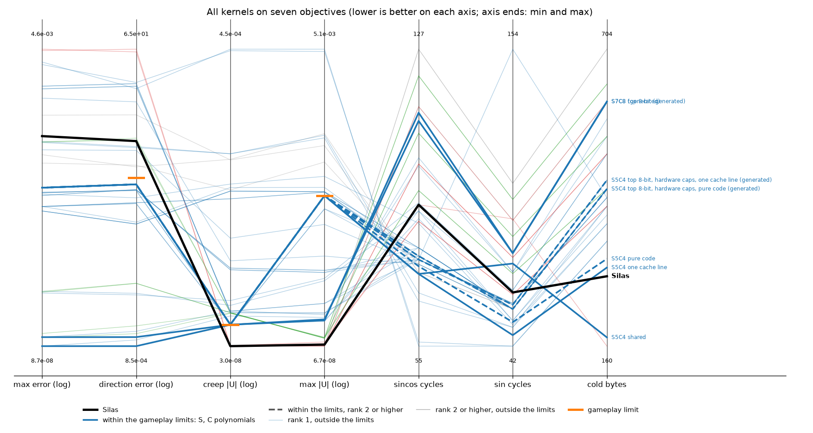

# N64-trig: sine and cosine kernels for the N64

> [!NOTE]
> - **AI use:** I am a mathematician. I designed the approximation: the polynomial forms, the fit, the 8-bit coefficients, and the constants in one cache line. I directed the work. Claude (the AI from Anthropic) wrote the code, the assembly, the benchmark and the report. The project contains no art, models or music.
> - **Source of the figures:** This documentation is generated from the experiment logs. All figures come from the benchmark results in [`bench/results/`](bench/results/) and from the scripts in [`fit/`](fit/) and [`bench/`](bench/). Refer to [Reproduce](#reproduce).
> - **Style guide:** This documentation uses ASD-STE100 Simplified Technical English.

This repository contains two sine and cosine kernels for the N64 CPU (VR4300): S5C4 and S5C6. It compares them with the kernel from Silas Lock.

## Summary

Silas, and the two S5C4 versions with two functions (`trig_sincos` and `trig_sin`):

<!-- gen:summary-table -->
| | Silas | S5C4 pure code | S5C4 one cache line |
|---|---|---|---|
| Max error | 1.92e-04 | 2.89e-05 | 2.89e-05 |
| Max direction error (1/65536 turn) | 2.00 | 0.39 | 0.39 |
| Creep: max \|s²+c²−1\|, turns of 0° to 6° | 3.0e-08 | 6.0e-08 | 6.0e-08 |
| Max \|s²+c²−1\| | 7.1e-08 | 2.0e-05 | 2.0e-05 |
| CPU cycles for one `trig_sincos` call | 89.0 | 74.0 | 72.2 |
| CPU cycles for one `trig_sin` call | 62.2 | 51.0 | 46.1 |
| Code (cache lines) and data | 156 + 120 B (9 lines) | 168 + 124 B (10 lines) | 144 + 128 B (9 lines) + 16 B data |
| CPU time in the game, µs per frame, `sincoss()` | 12,309 ± 49 | 12,283 ± 47 (−27 ± 7) | 12,281 ± 44 (−28 ± 7) |
| Memory traffic in the game, bytes per frame, `sincoss()` | 545,023 ± 1,872 | 545,670 ± 1,701 (+647 ± 831) | 545,406 ± 1,178 (+383 ± 1,093) |
| CPU time in the game, µs per frame, separate calls | 12,538 ± 148 | 12,481 ± 149 (−57 ± 7) | 12,463 ± 148 (−76 ± 10) |
| Memory traffic in the game, bytes per frame, separate calls | 554,276 ± 9,027 | 554,614 ± 9,220 (+338 ± 395) | 554,951 ± 9,075 (+675 ± 525) |
<!-- /gen:summary-table -->

Accuracy: exact values over all 65,536 angles (experiment 1). Cycles: median of 5 runs of a timing ROM (experiment 2). In-game values: mean ± 95 % confidence interval over 8 samples (experiment 4). In brackets: the paired difference from Silas.

## Criteria

This repository compares sine and cosine kernels by three criteria:

1. **Memory traffic.** The bytes that the CPU moves over the RDRAM bus. The CPU shares this bus with the RCP.
2. **Instructions and CPU cycles.**
3. **Accuracy.** The error of the sine and the cosine, and how well the sine and the cosine agree (s² + c² − 1).

The baseline is the kernel from Silas Lock: a 4th-order cosine polynomial, with the sine from a square root.

| Criterion | Experiment |
|---|---|
| 3. Accuracy | [1. Accuracy](#1-accuracy) |
| 2. Instructions and cycles | [2. Cost for each call](#2-cost-for-each-call), [4. Like-for-like comparison in the game](#4-like-for-like-comparison-in-the-game) |
| 1. Memory traffic | [2. Cost for each call](#2-cost-for-each-call) (bytes when cold), [4. Like-for-like comparison in the game](#4-like-for-like-comparison-in-the-game) |
| All three | [3. Pareto frontiers](#3-pareto-frontiers) |

### Gameplay limits

The S5C4 coefficients come from a search with four limits ([`fit/hwsearch.py`](fit/hwsearch.py)). Each limit is a property of the N64 or of float32:

| Limit | Value | Source of the value |
|---|---|---|
| Direction error | Less than 0.5 × 1/65536 turn | The (cos, sin) pair points to the nearest binary angle. |
| Creep | Max \|s² + c² − 1\| ≤ 6.0e-8 for turns of 0° to 6° (1 to 1,092 binary-angle steps) | The value for correctly rounded float32 sine and cosine. A rotation that is applied to its own result once per frame changes lengths by approximately half of this value per frame. |
| Length | Max \|s² + c² − 1\| ≤ 2e-5 for all angles | The rounding of the 16.16 fixed-point matrices of the RSP. |
| Range | \|sin\| and \|cos\| never above 1 | |

## Terms

| Term | Meaning |
|---|---|
| Angle | An SM64 or MM binary angle. 0x10000 is one turn. The kernels use only the low 16 bits. |
| Fold | The method that changes the angle to x, the offset from the nearest quarter turn. x is 45° or less. A polynomial in x, with a sign, gives the sine or the cosine of all angles. Silas Lock designed this method. |
| S5C4, S5C6 | The kernels of this repository. The sine polynomial goes to x⁵. The cosine polynomial goes to x⁴ (S5C4) or x⁶ (S5C6). |
| Silas | The kernel from Silas Lock: a 4th-order cosine polynomial, and the sine from a square root. |
| `trig_sin` | A kernel function that returns one value. For the cosine, call `trig_sin(angle + 0x4000)`. |
| `trig_sincos` | A kernel function that returns the sine and the cosine of one angle. In C, `sincoss(angle, s, c)` calls it. |
| Shared | A kernel with only `trig_sincos`. A single sine or cosine call runs `trig_sincos` and uses one of the two values. |
| s² + c² − 1 | A measure of how well a sine and a cosine agree. A rotation made from them changes lengths by approximately half of this value. |
| Creep | Max \|s² + c² − 1\| for turns of 0° to 6°. Refer to [Gameplay limits](#gameplay-limits). |
| Cold bytes | The bytes that the functions and the data of a kernel move over the RDRAM bus when none of them is in the cache: the 32-byte instruction-cache lines of each function, and one 16-byte line of data. |
| Memory traffic | The bytes that the CPU moves over the RDRAM bus: instruction-cache fills, data-cache fills and write-backs, and uncached accesses. The emulator counts them on the bus. |
| Sample | One random draw of the test conditions: the positions of code and data in memory, and the random seed of the game. |
| Pareto set | The kernels that no other kernel equals or beats in all objectives and beats in one. |
| ± | The half-width of the 95 % confidence interval of the mean (Student's t). |

## How the kernels work

S5C4 and S5C6 calculate two polynomials of the folded x:

    S5C4:  S(x) = x(a + x²(b + cx²))           C(x) = 1 + x²(d + ex²)
    S5C6:  S(x) = x(a + x²(b + cx²))           C(x) = 1 + x²(d + x²(e + fx²))

Silas calculates one polynomial. It calculates the other value with a square root:

    Silas: C(x) = 1 + x²(a + bx²)              S(x) = √(1 − C(x)²)

Design decisions:

- The nested form (Horner form) needs one multiplication and one addition for each coefficient. There is no square root.
- The highest coefficient of each polynomial has 8 significant bits. One `lui` instruction loads each of them.
- The S5C4 coefficients come from a search of float32 bit patterns under the [gameplay limits](#gameplay-limits) ([`fit/hwsearch.py`](fit/hwsearch.py)). The search scores the float32 output of the kernel, with the operations of the kernel in the same order.

## Versions

The versions of a kernel have the same fold, the same polynomials and the same coefficients, except the quantized version. They load the coefficients in different ways. All versions of one kernel give the same values, bit for bit (except the quantized version).

| Kernel | Version | Files | Constants | Data |
|---|---|---|---|---|
| S5C4 | One cache line | [`kernel/s5c4_line.s`](kernel/s5c4_line.s), [`kernel/s5c4.c`](kernel/s5c4.c) | a, b, d and 1.0: one 16-byte data line. c and e: one `lui` each. | 16 B |
| S5C4 | Pure code | [`kernel/s5c4_code.s`](kernel/s5c4_code.s) | a, b and d: `lui` + `ori`. c, e and 1.0: one `lui` each. | None |
| S5C4 | Shared | [`kernel/s5c4_shared.s`](kernel/s5c4_shared.s), [`kernel/s5c4.c`](kernel/s5c4.c) | As one cache line. Only `trig_sincos`. `trig_sin` is the same address. | 16 B |
| S5C6 | One cache line | [`kernel/s5c6.s`](kernel/s5c6.s), [`kernel/sincos.s`](kernel/sincos.s), [`kernel/s5c6.c`](kernel/s5c6.c) | a, b, d and e: one 16-byte data line. c, f and 1.0: one `lui` each. | 16 B |
| S5C6 | Pure code | [`kernel/s5c6_code.s`](kernel/s5c6_code.s), [`kernel/sincos_code.s`](kernel/sincos_code.s) | a, b, d and e: `lui` + `ori`. c, f and 1.0: one `lui` each. | None |
| S5C6 | Quantized | [`kernel/s5c6_quantized.s`](kernel/s5c6_quantized.s), [`kernel/sincos_quantized.s`](kernel/sincos_quantized.s) | a: `lui` + `ori`. b to f and 1.0: one `lui` each. Its own coefficients ([`fit/fit_quantized.py`](fit/fit_quantized.py)). | None |

- **S5C4 `trig_sin`, pure code:** the sine path and the cosine path load their three constants into the same registers and use one shared tail. The last factor of the cosine is 1.0. Thus the values are bit-identical to the separate polynomials.
- **S5C4 `trig_sin`, one cache line:** a branch-likely instruction (`bnezl`) does the last negation.

## Use

### To replace the SM64 functions

1. Assemble one `kernel/s5c4_*.s` or `kernel/s5c6*.s` file.
2. For a version with a data line: also compile [`kernel/s5c4.c`](kernel/s5c4.c) (S5C4) or [`kernel/s5c6.c`](kernel/s5c6.c) (S5C6). This file contains the constant line `trig_k` (16 bytes, 16-byte aligned).
3. Include [`kernel/s5c6.h`](kernel/s5c6.h). It gives `sins(a)`, `coss(a)` and `sincoss(a, s, c)` for all kernels.

### To get the sine and the cosine of one angle

Call `sincoss(angle, s, c)`. It sets `s` to the sine and `c` to the cosine with one `trig_sincos` call.

### Calling convention

| Item | Value |
|---|---|
| Input | The angle in `$a0`. |
| `trig_sin` output | `$f0`. |
| `trig_sincos` output | The sine in `$f0` and the cosine in `$f2` (GNU C `_Complex float`). No value goes through memory. |
| Stack | Not used. All functions are leaf functions. |
| Registers changed | Only caller-saved registers: `$t0`–`$t9`, and the even registers `$f0`–`$f16`. |
| Syntax | GNU as, o32 ABI. |
| VR4300 hazards | No multiplication immediately after `mul.s`. No `mul.s` in a branch delay slot. At least one instruction between `mtc1` or `lwc1` and the first use of its register. [`bench/micro/hazards.py`](bench/micro/hazards.py) checks all kernels. |

## 1. Accuracy

[`bench/frontier.py`](bench/frontier.py) calculates `trig_sin(a)` and `trig_sin(a + 0x4000)` of all 65,536 angles with a float32 model of each kernel. The model does the operations of the assembly in the same order. The reference is float64. The values are exact, because the script calculates all angles. For each kernel, the CRC-32 of the model output is equal to the CRC-32 of the kernel output in the timing ROM (experiment 2).

<!-- gen:accuracy -->
| Kernel | Max error | Max direction error (1/65536 turn) | Creep: max \|s²+c²−1\|, turns of 0° to 6° | Max \|s²+c²−1\| | Mean s²+c²−1 (drift) | \|sin\|, \|cos\| never above 1 | Within the gameplay limits |
|---|---|---|---|---|---|---|---|
| Silas | 1.92e-04 | 2.00 | 3.0e-08 | 7.1e-08 | +2.6e-10 | Yes | No |
| S5C6 one cache line | 1.45e-05 | 0.19 | 6.1e-08 | 1.7e-07 | +1.8e-09 | Yes | No |
| S5C6 pure code | 1.45e-05 | 0.19 | 6.1e-08 | 1.7e-07 | +1.8e-09 | Yes | No |
| S5C6 quantized | 2.28e-05 | 0.23 | 5.7e-06 | 4.1e-05 | +2.9e-07 | Yes | No |
| S5C4 one cache line | 2.89e-05 | 0.39 | 6.0e-08 | 2.0e-05 | -2.3e-06 | Yes | Yes |
| S5C4 pure code | 2.89e-05 | 0.39 | 6.0e-08 | 2.0e-05 | -2.3e-06 | Yes | Yes |
<!-- /gen:accuracy -->

- **Direction error:** The difference between the direction of the (cos, sin) pair and the true angle, in units of 1/65536 turn.
- **Drift:** The mean of s² + c² − 1 over all angles.
- **Silas at 0° and 180°:** Within 2 steps of 0° and 180°, 1 − c² rounds to 0, and the sine of Silas is exactly 0.

## 2. Cost for each call

A timing ROM ([`bench/micro/`](bench/micro/)) runs each kernel in [Ares 64](https://github.com/HailToDodongo/ares-64) (commit b4ead632f), with the CPU interpreter:

- The ROM contains no Nintendo code: it boots with the public-domain IPL3 of libdragon ([`bench/micro/IPL3_LICENSE.md`](bench/micro/IPL3_LICENSE.md)).
- Each function runs on 4,096 pseudo-random angles. A first pass fills the caches. Thus, the caches are warm.
- The cost of an empty function is subtracted. The unit is CPU cycles (93.75 MHz).
- The value is the median of 5 runs ([`bench/results/micro/`](bench/results/micro/)).
- The ROM also checks that `trig_sincos` is equal to two `trig_sin` calls, for all 65,536 angles.

<!-- gen:cost -->
| Kernel | `trig_sincos` bytes | `trig_sin` bytes | Data bytes | Cold bytes | `trig_sincos` cycles | `trig_sin` cycles |
|---|---|---|---|---|---|---|
| Silas | 156 | 120 | None | 288 | 89.0 | 62.2 |
| S5C6 one cache line | 176 | 168 | 16 | 400 | 85.7 | 51.6 |
| S5C6 pure code | 200 | 192 | None | 416 | 87.5 | 51.5 |
| S5C6 quantized | 188 | 180 | None | 384 | 84.5 | 50.0 |
| S5C4 one cache line | 144 | 128 | 16 | 304 | 72.2 | 46.1 |
| S5C4 pure code | 168 | 124 | None | 320 | 74.0 | 51.0 |
| S5C4 shared | 144 | (the `trig_sincos` function) | 16 | 176 | 72.2 | 73.2 |
| Silas, shared | 156 | (the `trig_sincos` function) | None | 160 | 89.0 | 90.0 |
<!-- /gen:cost -->

- **Bytes:** the size of each function. **Cold bytes:** refer to [Terms](#terms).
- **Shared:** a single sine or cosine call runs `trig_sincos`.
- `build.py --hardware` makes a version of the timing ROM for a console. It shows the results on the screen ([`bench/micro/expected-console.png`](bench/micro/expected-console.png)).

## 3. Pareto frontiers

[`bench/frontier.py`](bench/frontier.py) compares 55 kernels by seven objectives. Lower is better for each objective:

| Objective | Source |
|---|---|
| Max error, max direction error, creep, max \|s² + c² − 1\| | Experiment 1 (the float32 model) |
| `trig_sincos` cycles, `trig_sin` cycles | Experiment 2 (the timing ROM) |
| Cold bytes | The symbol sizes of the timing ROM |

The kernels:

- The hand-written kernels of [Versions](#versions), Silas, and Silas shared.
- Generated kernels ([`bench/micro/gen.py`](bench/micro/gen.py)): polynomial pairs (S3C2 to S7C8), and forms with a square root (a cosine polynomial with the sine from a square root, and the opposite). Each form has float32 coefficients ("free"), and 8-bit highest coefficients ("top 8-bit"). There are also S5C4 coefficient variants from [`fit/variants.py`](fit/variants.py) and [`fit/hwsearch.py`](fit/hwsearch.py), in pure code and with one data line.

Method:

- **Rank:** non-dominated sorting on the seven objectives. Rank 1 is the Pareto set. Rank 2 is the Pareto set of the other kernels, and so on.
- **Pareto set within the gameplay limits:** the kernels within the [gameplay limits](#gameplay-limits), ranked on the three costs only.
- **Parallel coordinates** ([`fit/frontier-parallel.png`](fit/frontier-parallel.png)): one line for each kernel, one vertical axis for each objective. The accuracy axes are logarithmic.
- **Scatterplot matrix** ([`fit/frontier-matrix.png`](fit/frontier-matrix.png)): all 21 pairs of objectives, with the Pareto frontier of each pair.




<!-- gen:frontier -->
Kernels: 55. Within the gameplay limits: 7. For each kernel, the CRC of the model output is equal to the CRC of the timing ROM.

**Pareto set within the gameplay limits.** The kernels within the limits that no other kernel within the limits equals or beats in the three costs (sincos cycles, sin cycles, cold bytes) and beats in one (2 kernels):

| Kernel | Form | Coefficients | max error | direction error | creep \|U\| | max \|U\| | sincos cycles | sin cycles | cold bytes | Within the gameplay limits |
|---|---|---|---|---|---|---|---|---|---|---|
| S5C4 one cache line | S, C polynomials | top 8-bit | 2.9e-05 | 0.39 | 6.0e-08 | 2.0e-05 | 72.2 | 46.1 | 304 | Yes |
| S5C4 shared | S, C polynomials | top 8-bit | 2.9e-05 | 0.39 | 6.0e-08 | 2.0e-05 | 72.2 | 73.2 | 176 | Yes |

<details><summary>Pareto set on all seven objectives (46 of 55 kernels)</summary>

| Kernel | Form | Coefficients | max error | direction error | creep \|U\| | max \|U\| | sincos cycles | sin cycles | cold bytes | Within the gameplay limits |
|---|---|---|---|---|---|---|---|---|---|---|
| S3C2 top 8-bit (generated) | S, C polynomials | top 8-bit | 2.9e-03 | 14.58 | 4.5e-04 | 5.1e-03 | 54.5 | 42.0 | 352 | No |
| S3C2 (generated) | S, C polynomials | free | 2.6e-03 | 18.40 | 4.3e-04 | 4.7e-03 | 55.5 | 42.0 | 352 | No |
| S3C4 top 8-bit (generated) | S, C polynomials | top 8-bit | 1.6e-04 | 1.62 | 1.5e-05 | 1.8e-04 | 65.5 | 49.1 | 384 | No |
| S3C4 (generated) | S, C polynomials | free | 1.5e-04 | 1.56 | 1.5e-05 | 2.0e-04 | 67.5 | 49.1 | 416 | No |
| S5C4 one cache line | S, C polynomials | top 8-bit | 2.9e-05 | 0.39 | 6.0e-08 | 2.0e-05 | 72.2 | 46.1 | 304 | Yes |
| S5C4 shared | S, C polynomials | top 8-bit | 2.9e-05 | 0.39 | 6.0e-08 | 2.0e-05 | 72.2 | 73.2 | 176 | Yes |
| S5C4 quantized, balance, pure code (generated) | S, C polynomials | quantized | 1.2e-04 | 1.41 | 9.8e-07 | 6.7e-06 | 74.5 | 56.0 | 448 | No |
| S5C4 quantized, min U, pure code (generated) | S, C polynomials | quantized | 7.7e-04 | 8.84 | 4.7e-07 | 2.0e-06 | 74.5 | 56.0 | 448 | No |
| S5C4 free, balance, one cache line (generated) | S, C polynomials | free | 2.2e-05 | 0.32 | 3.5e-07 | 1.1e-06 | 75.7 | 58.1 | 432 | No |
| S5C4 free, hardware caps, one cache line (generated) | S, C polynomials | free | 2.4e-05 | 0.31 | 6.0e-08 | 1.2e-05 | 75.7 | 58.1 | 432 | No |
| S5C4 free, min E, one cache line (generated) | S, C polynomials | free | 1.2e-05 | 0.09 | 4.5e-06 | 2.3e-05 | 75.7 | 58.1 | 432 | No |
| S5C4 free, min U, one cache line (generated) | S, C polynomials | free | 1.1e-03 | 15.98 | 9.2e-08 | 3.4e-07 | 75.7 | 154.1 | 432 | No |
| S5C4 top 8-bit, balance, one cache line (generated) | S, C polynomials | top 8-bit | 2.4e-05 | 0.31 | 3.7e-07 | 1.2e-06 | 75.7 | 57.6 | 464 | No |
| S5C4 top 8-bit, min E, one cache line (generated) | S, C polynomials | top 8-bit | 1.5e-05 | 0.19 | 3.5e-06 | 2.3e-05 | 75.7 | 57.6 | 464 | No |
| S5C4 top 8-bit, min U, one cache line (generated) | S, C polynomials | top 8-bit | 1.2e-03 | 17.62 | 8.8e-08 | 2.3e-07 | 75.7 | 57.6 | 464 | No |
| S5C4 top 8-bit (generated) | S, C polynomials | top 8-bit | 1.5e-05 | 0.09 | 5.1e-06 | 2.7e-05 | 76.5 | 56.0 | 448 | No |
| S5C4 top 8-bit, balance, pure code (generated) | S, C polynomials | top 8-bit | 2.4e-05 | 0.31 | 3.7e-07 | 1.2e-06 | 76.5 | 56.0 | 448 | No |
| S5C4 top 8-bit, min E, pure code (generated) | S, C polynomials | top 8-bit | 1.5e-05 | 0.19 | 3.5e-06 | 2.3e-05 | 76.5 | 56.0 | 448 | No |
| S5C4 top 8-bit, min U, pure code (generated) | S, C polynomials | top 8-bit | 1.2e-03 | 17.62 | 8.8e-08 | 2.3e-07 | 76.5 | 56.0 | 448 | No |
| S5C4 (generated) | S, C polynomials | free | 1.2e-05 | 0.09 | 4.5e-06 | 2.3e-05 | 78.5 | 56.0 | 448 | No |
| S5C4 free, hardware caps, pure code (generated) | S, C polynomials | free | 2.4e-05 | 0.31 | 6.0e-08 | 1.2e-05 | 78.5 | 56.0 | 448 | No |
| S5C4 free, min E, pure code (generated) | S, C polynomials | free | 1.2e-05 | 0.09 | 4.5e-06 | 2.3e-05 | 78.5 | 56.0 | 448 | No |
| S5C4 free, balance, pure code (generated) | S, C polynomials | free | 2.2e-05 | 0.32 | 3.5e-07 | 1.1e-06 | 78.5 | 56.0 | 448 | No |
| S5C4 free, min U, pure code (generated) | S, C polynomials | free | 1.1e-03 | 15.98 | 9.2e-08 | 3.4e-07 | 78.5 | 56.0 | 448 | No |
| S5C6 quantized | S, C polynomials | quantized | 2.3e-05 | 0.23 | 5.7e-06 | 4.1e-05 | 84.5 | 50.0 | 384 | No |
| C2+sqrt (generated) | C + sqrt | free | 4.4e-03 | 64.96 | 3.0e-08 | 7.4e-08 | 85.0 | 61.4 | 416 | No |
| C2+sqrt top 8-bit (generated) | C + sqrt | top 8-bit | 4.6e-03 | 58.57 | 3.0e-08 | 7.8e-08 | 85.0 | 61.4 | 416 | No |
| S5C6 one cache line | S, C polynomials | top 8-bit | 1.4e-05 | 0.19 | 6.1e-08 | 1.7e-07 | 85.7 | 51.6 | 400 | No |
| S5C6 pure code | S, C polynomials | top 8-bit | 1.4e-05 | 0.19 | 6.1e-08 | 1.7e-07 | 87.5 | 51.5 | 416 | No |
| S5C6 top 8-bit (generated) | S, C polynomials | top 8-bit | 6.5e-07 | 0.01 | 1.1e-07 | 7.9e-07 | 87.5 | 63.1 | 512 | No |
| Silas, shared | C + sqrt | free | 1.9e-04 | 2.00 | 3.0e-08 | 7.1e-08 | 89.0 | 90.0 | 160 | No |
| Silas | C + sqrt | free | 1.9e-04 | 2.00 | 3.0e-08 | 7.1e-08 | 89.0 | 62.2 | 288 | No |
| S5C6 (generated) | S, C polynomials | free | 6.1e-07 | 0.01 | 1.3e-07 | 8.7e-07 | 89.5 | 63.1 | 512 | No |
| S3+sqrt (generated) | S + sqrt | free | 1.5e-04 | 2.24 | 8.8e-08 | 9.3e-08 | 92.5 | 69.3 | 448 | No |
| S3+sqrt top 8-bit (generated) | S + sqrt | top 8-bit | 1.6e-04 | 2.05 | 8.9e-08 | 9.0e-08 | 92.5 | 69.3 | 448 | No |
| S7C6 top 8-bit (generated) | S, C polynomials | top 8-bit | 1.2e-07 | 0.00 | 9.4e-08 | 2.2e-07 | 98.5 | 70.0 | 544 | No |
| C4+sqrt (generated) | C + sqrt | free | 1.9e-04 | 2.00 | 3.0e-08 | 6.9e-08 | 99.0 | 75.4 | 512 | No |
| C4+sqrt top 8-bit (generated) | C + sqrt | top 8-bit | 1.9e-04 | 2.00 | 3.0e-08 | 6.7e-08 | 99.0 | 75.4 | 512 | No |
| S7C6 (generated) | S, C polynomials | free | 8.7e-08 | 0.00 | 7.9e-08 | 2.0e-07 | 100.5 | 70.0 | 576 | No |
| S5+sqrt (generated) | S + sqrt | free | 6.3e-07 | 0.01 | 8.8e-08 | 9.0e-08 | 106.5 | 83.3 | 544 | No |
| S5+sqrt top 8-bit (generated) | S + sqrt | top 8-bit | 6.5e-07 | 0.01 | 8.8e-08 | 9.0e-08 | 106.5 | 83.3 | 544 | No |
| S7C8 top 8-bit (generated) | S, C polynomials | top 8-bit | 1.2e-07 | 0.00 | 6.0e-08 | 1.8e-07 | 109.5 | 77.1 | 608 | Yes |
| S7C8 (generated) | S, C polynomials | free | 8.7e-08 | 0.00 | 6.0e-08 | 1.8e-07 | 111.5 | 77.1 | 608 | Yes |
| C6+sqrt (generated) | C + sqrt | free | 1.9e-04 | 2.00 | 3.0e-08 | 6.7e-08 | 113.0 | 89.4 | 608 | No |
| S7+sqrt (generated) | S + sqrt | free | 1.2e-07 | 0.00 | 8.7e-08 | 9.3e-08 | 120.5 | 97.3 | 640 | No |
| S7+sqrt top 8-bit (generated) | S + sqrt | top 8-bit | 1.4e-07 | 0.00 | 8.7e-08 | 9.1e-08 | 120.5 | 97.3 | 640 | No |

</details>
<!-- /gen:frontier -->

[`fit/pareto.png`](fit/pareto.png) shows the frontier of max error against max \|s² + c² − 1\| for S5C6 coefficient families ([`fit/pareto.py`](fit/pareto.py)).

## 4. Like-for-like comparison in the game

Each match-up compares kernels with the same function structure:

- **Two functions:** `trig_sincos` and `trig_sin`. The reference is Silas.
- **One function:** only `trig_sincos`, also for single calls. The reference is Silas shared.

| Item | Value |
|---|---|
| Game | [HackerSM64](https://github.com/HackerN64/HackerSM64), commit 3be00d2f, clang 21, `-Os` |
| Emulator | Ares 64 (commit b4ead632f), headless, CPU interpreter (it fetches every instruction through the modelled caches), RSP recompiler |
| Input | The seven attract-mode demos of SM64: 4,304 measured frames |
| Builds | **`sincoss()`:** 13 functions get the sine and the cosine of one angle from one `trig_sincos` call ([`bench/hsm64-sincos.patch`](bench/hsm64-sincos.patch)). **Separate calls:** the game calls `sins()` and `coss()`. |
| Kernel slot | The build has a fixed slot for the kernel ([`bench/trig_slot.s`](bench/trig_slot.s)). [`bench/slot.py`](bench/slot.py) writes each kernel into a copy of the ROM. Thus the ROMs of one sample are different only in the slot. |
| Samples | 8. Each sample is one build with a random draw of the code shift, the data shift, the heap shift and the game seed ([`bench/sample.py`](bench/sample.py)). |
| Result | The mean ± 95 % confidence interval. In brackets: the paired difference from the reference in the same sample, with its own interval. |
| Scripts | [`bench/fast.py`](bench/fast.py) (runs), [`bench/fair.py`](bench/fair.py) (tables and plot) |

<!-- gen:fair -->
8 samples.

**Two functions (`trig_sincos` and `trig_sin`).** Reference: Silas.

| Kernel | Code (cache lines) and data | `sincoss()`: CPU time, µs per frame | `sincoss()`: memory traffic, bytes per frame | Separate calls: CPU time, µs per frame | Separate calls: memory traffic, bytes per frame |
|---|---|---|---|---|---|
| Silas | 156 + 120 B (9 lines) | 12,309 ± 49 | 545,023 ± 1,872 | 12,538 ± 148 | 554,276 ± 9,027 |
| S5C4 one cache line | 144 + 128 B (9 lines) + 16 B data | 12,281 ± 44 (−28 ± 7) | 545,406 ± 1,178 (+383 ± 1,093) | 12,463 ± 148 (−76 ± 10) | 554,951 ± 9,075 (+675 ± 525) |
| S5C4 pure code | 168 + 124 B (10 lines) | 12,283 ± 47 (−27 ± 7) | 545,670 ± 1,701 (+647 ± 831) | 12,481 ± 149 (−57 ± 7) | 554,614 ± 9,220 (+338 ± 395) |

**One function (only `trig_sincos`, also for single calls).** Reference: Silas, shared.

| Kernel | Code (cache lines) and data | `sincoss()`: CPU time, µs per frame | `sincoss()`: memory traffic, bytes per frame | Separate calls: CPU time, µs per frame | Separate calls: memory traffic, bytes per frame |
|---|---|---|---|---|---|
| Silas, shared | 156 B (5 lines) | 12,313 ± 49 | 544,633 ± 1,535 | 12,727 ± 148 | 557,196 ± 9,512 |
| S5C4 shared | 144 B (5 lines) + 16 B data | 12,286 ± 43 (−27 ± 8) | 545,411 ± 1,189 (+778 ± 807) | 12,646 ± 149 (−81 ± 8) | 557,409 ± 9,641 (+213 ± 632) |
<!-- /gen:fair -->


## 5. S5C6 in the game

The S5C6 versions were compared with Silas in an earlier set of runs. Each sample of these runs is a full build of each kernel.

### Method

<!-- gen:method -->
| Item | Value |
|---|---|
| Game | [HackerSM64](https://github.com/HackerN64/HackerSM64), commit 3be00d2f, clang 21, `-Os` |
| Emulator | [Ares 64](https://github.com/HailToDodongo/ares-64) (commit b4ead632f), headless, CPU interpreter: it fetches every instruction through the modelled caches ([`bench/ares64.js`](bench/ares64.js)) |
| Input | The seven attract-mode demos of SM64: 4,304 measured frames, with approximately 456 sine and cosine calls per frame |
| Builds | Two for each kernel. **`sincoss()`:** [`bench/hsm64-sincos.patch`](bench/hsm64-sincos.patch) changes 13 functions to get the sine and the cosine of one angle from one `trig_sincos` call. These 13 functions make 98 % of the sine and cosine pairs. **Separate calls:** the game calls `sins()` and `coss()`, and each is one `trig_sin` call. |
| Test conditions | 64 samples. Each sample is one random draw of the four conditions below ([`bench/sample.py`](bench/sample.py)). All builds of a sample use the same draw. |
| Result | The mean of the 64 samples ± the 95 % confidence interval (Student's t). In brackets: the difference from Silas in the same sample, with its own confidence interval. |

**Test conditions:** The position of code and data in memory decides which of them collide in the caches. These collisions change each result by chance, by up to approximately ±3 %. Each sample draws the positions and the game state at random, from the full period of each cache:

| Condition | Draw | Effect |
|---|---|---|
| Code shift | 0 to 16 KB of padding before the kernel, in 32-byte steps | Instruction-cache collisions (16 KB cache, 32-byte lines) |
| Data shift | 0 to 8 KB of `.bss` padding, in 16-byte steps | Data-cache collisions of the static data (8 KB cache, 16-byte lines) |
| Heap shift | 0 to 8 KB added to the start of the main pool, in 16-byte steps | Data-cache collisions of all data that the game allocates at run time |
| Game seed | 0 to 65,113 steps of the random generator of the game, at boot | The random choices of the objects. The demos give the same input. |

All four conditions are uniform and independent. Each sample has its own random generator, so the samples are independent. New samples are added over time. The tables include all finished samples.
<!-- /gen:method -->

### Memory traffic

Bytes per frame that the CPU moves over the RDRAM bus, counted by the emulator on the bus.

<!-- gen:traffic -->
| | `sincoss()` at the 13 changed call sites | Separate `sins()` and `coss()` calls |
|---|---|---|
| Silas | 543,105 ± 3,035 | 551,562 ± 3,496 |
| S5C6 one cache line | 545,259 ± 3,143 (+2,154 ± 1,390) | 553,459 ± 3,639 (+1,897 ± 1,600) |
| S5C6 pure code | 545,275 ± 3,313 (+2,169 ± 1,690) | 552,762 ± 3,841 (+1,200 ± 1,631) |
| S5C6 quantized | 544,761 ± 3,285 (+1,656 ± 1,396) | 552,666 ± 3,813 (+1,103 ± 1,625) |
<!-- /gen:traffic -->

### CPU time

Game-thread CPU time from the HackerSM64 profiler, in µs per frame. Audio is not included.

<!-- gen:cputime -->
| | `sincoss()` at the 13 changed call sites | Separate `sins()` and `coss()` calls |
|---|---|---|
| Silas | 12,282 ± 55 | 12,536 ± 66 |
| S5C6 one cache line | 12,307 ± 58 (+25 ± 26) | 12,519 ± 68 (−17 ± 31) |
| S5C6 pure code | 12,303 ± 60 (+20 ± 30) | 12,498 ± 71 (−37 ± 30) |
| S5C6 quantized | 12,293 ± 61 (+11 ± 26) | 12,490 ± 71 (−46 ± 30) |
<!-- /gen:cputime -->

## Checks

| Check | Result |
|---|---|
| Is `trig_sincos` equal to two `trig_sin` calls? | Yes, bit for bit, for all 65,536 angles and all kernels. The timing ROM and each game ROM do this check. |
| Is the float32 model equal to the kernel? | Yes. For each of the 55 kernels, the CRC-32 of the model output is equal to the CRC-32 of the timing ROM. |
| VR4300 hazards? | None. [`bench/micro/hazards.py`](bench/micro/hazards.py) checks each kernel of the timing ROM. A test file with each hazard gives each finding. |
| Gameplay (S5C6) | With each S5C6 version, Mario stays within 0.06 units of the run with the SM64 table in all demos. |
| Denormals, NaN or infinity? | None in any intermediate value, for all angles and all kernels. |
| Negative zero? | sin(0x8000) and cos(0x4000) return −0.0. No code in SM64 divides by these values. |
| Built with IDO? | S5C6 one-cache-line version only. Built in the vanilla SM64 decompilation (IDO 5.3, GNU as for the kernel): 559 call sites, all 65,536 values checked in the ROM, 4,800 frames run. |

## Console test

[`bench/hardware/`](bench/hardware/) contains a test package for a console: BPS patches for HackerSM64, the exact base ROM to use, and the expected screens. Refer to [`bench/hardware/README.md`](bench/hardware/README.md). The timing ROM of experiment 2 also runs on a console (`bench/micro/build.py --hardware`).

## Reproduce

```sh
uv run --with numpy --with scipy python3 fit/hwsearch.py          # S5C4 coefficients under the gameplay limits
python3 bench/micro/build.py --clang BIN --binutils BIN --forms fit/forms.json fit/variants-S5C4-builds.json fit/hwsearch-S5C4-builds.json --out work/micro
ares-test bench/micro/micro.js work/micro/micro.z64 interp       # experiment 2 (5 runs -> bench/results/micro/runN.log)
uv run --with numpy --with matplotlib python3 bench/frontier.py --readme   # experiments 1 and 3
python3 bench/fast.py run --name hand-sincos --kernels Silas S5C4_line S5C4_pure Silas+shared S5C4_shared --clang BIN --binutils BIN --baserom sm64.us.z64 --ares ARES_TEST
python3 bench/fast.py run --name hand-separate --separate --kernels ...    # experiment 4
uv run --with matplotlib python3 bench/fair.py                   # experiment 4 plot
python3 bench/readme.py                                          # the in-game tables of this README
python3 bench/sample.py --baserom sm64.us.z64 --clang BIN --binutils BIN   # experiment 5
```

- `bench/hsm64-bench.patch` adds the benchmark to HackerSM64.
- ares is deterministic: a ROM gives the same counts in each run. Thus, results saved at different times can be combined.
- The docstring of each script gives its options.

## Credits and license

- Silas Lock designed the fold (refer to [Terms](#terms)) and the baseline kernel.
- License: MIT.
- The repository contains no ROMs.
